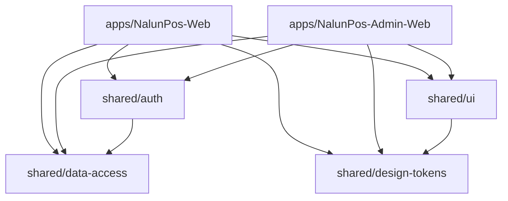

# Arquitectura Frontend — NalunPos Enterprise (Angular 22 Monorepo)

## 1. Propósito y Estructura Global

El ecosistema frontend de **NalunPos** está construido sobre un **Monorepo Nx** con **Angular 22** Zoneless, diseñado para máxima escalabilidad, rendimiento extremo y mantenibilidad a largo plazo (20+ años).

### 1.1 Aplicaciones (`apps/`)

- **`NalunPos-Admin-Web`**: Consola administrativa global para la gestión de la plataforma multi-tenant (SuperAdmin), monitoreo de sharding de bases de datos, métricas y administración de tenants.
- **`NalunPos-Web`**: Consola operativa de negocio (Admin Comercial / Tenant / Cajero), enfocada en el punto de venta (POS), ventas, inventario, almacenes, proveedores y clientes.

### 1.2 Librerías Compartidas (`libs/shared/`)

- **`libs/shared/auth`**: `AuthService`, interceptores de autorización (`authInterceptor`), guards funcionales (`authGuard`, `roleGuard`), interfaces tipadas y modelo de sesión de usuario `UserSession`.
- **`libs/shared/data-access`**: Configuración dinámica de runtime (`APP_CONFIG`, `AppConfigService`), interceptores globales (`correlationIdInterceptor`, `errorInterceptor`) y modelos de error estandarizados (`ProblemDetails`, `AppError`).
- **`libs/shared/ui`**: Componentes visuales puros reutilizables (`AppShellComponent`, `HeaderComponent`, `SidebarComponent`, `BaseLoginComponent`, `PageHeroCardComponent`, `MetricsBentoGridComponent`, `QuickFilterBarComponent`, `AdvancedFilterDrawerComponent`, `NotificationService`).
- **`libs/shared/design-tokens`**: Fuente única de verdad visual M3 (`theme.css`), tokens de diseño semánticos y tipografías auto-alojadas (`@fontsource`).

---

## 2. Regla de Dependencias y Module Boundaries (Clean Architecture)

El monorepo hace cumplir fronteras arquitectónicas automáticas mediante `@nx/enforce-module-boundaries` en ESLint:



1. **`apps/*`** consumen `libs/shared/*` según su scope (`scope:web`, `scope:admin-web`).
2. **`libs/shared/*`** **NUNCA** importan código de `apps/*`.
3. **`libs/shared/ui`** es de presentación pura; consume tokens de diseño y no realiza peticiones HTTP directas ni gestiona lógica de negocio.
4. **Cero Dependencias Circulares**: Cada capa tiene un flujo unidireccional estricto.

---

## 3. Patrón Feature Slice: Contenedores Inteligentes vs. Presentación Dumb

Cada módulo funcional (ej. `warehouses`, `categories`, `suppliers`) sigue una estructura modular estándar (ADR 0011):

```
features/<feature-name>/
├── components/          # Dumb components (presentación pura, inputs/outputs puros)
├── data-access/         # Servicios HTTP reactivos y adaptadores de datos
├── models/              # Interfaces, DTOs y tipos inmutables
├── pages/               # Smart/Container components (orquestación, señales, diálogos)
└── <feature>.routes.ts  # Rutas con lazy loading standalone
```

- **Smart / Container (`pages/`)**: Inyectan servicios, orquestan el estado reactivo con Signals (`signal`, `computed`), gestionan diálogos modales y emiten notificaciones.
- **Dumb / Presentation (`components/`)**: Reciben datos vía `input()` de Angular, emiten acciones del usuario vía `output()`, y mantienen `ChangeDetectionStrategy.OnPush` estricto sin inyectar servicios HTTP.

---

## 4. Diseño Visual: Material M3 + Tailwind CSS v4

Para erradicar conflictos de especificidad CSS y preservar una identidad visual empresarial:

1. **Angular Material M3**: Resuelve componentes complejos y accesibles (tablas con ordenamiento/paginación, diálogos, selectores, tooltips, snackbars).
2. **Tailwind CSS v4**: Resuelve layouts (`flex`/`grid`), micro-animaciones, efectos Glassmorphism y espaciados responsivos.
3. **Cero `!important`**: Queda estrictamente vetado el uso de `!important` en archivos de estilos. Toda personalización se deriva de tokens semánticos en `libs/shared/design-tokens/src/theme.css`.
4. **Tipografías Auto-Alojadas (Zero External Requests)**: Fuentes corporativas (`@fontsource/inter`, `@fontsource/jetbrains-mono`, `@fontsource/syne`, `@fontsource/cinzel`, `@fontsource-variable/material-symbols-outlined`) alojadas localmente sin dependencias externas hacia CDN de Google Fonts.

---

## 5. Configuración en Runtime (12-Factor App)

Las aplicaciones no contienen URLs de backend hardcodeadas (ADR 0009):

- En el arranque (`main.ts`), `provideAppInitializer()` solicita `/config.json` servido desde `public/`.
- La configuración se valida e inyecta a través del token fuertemente tipado `APP_CONFIG`.
- Principio **"Build Once, Deploy Anywhere"**: El mismo artefacto compilado en producción puede desplegarse en cualquier infraestructura modificando exclusivamente el archivo `/config.json`.

---

## 6. Estrategia de Calidad y Pruebas Automatizadas

1. **Pruebas Unitarias Rápidas con Vitest**:
   - Ejecutadas en entorno `jsdom` con inicialización JIT nativa de Angular 22 (`@angular/compiler` + `@angular/platform-browser/testing`).
   - Cobertura de código monitoreada con `@vitest/coverage-v8`, con umbral global obligatorio > 70% (actualmente > 96% en lógica de negocio).
2. **Pruebas E2E Smoke con Playwright**:
   - Pruebas end-to-end automatizadas en Chromium headless con interceptación y simulación de respuestas API mediante `page.route()`.
   - Verificación de carga de vistas de login, validaciones reactivas y redirección de navegación tras autenticación exitosa.

---

## 7. Directrices de Seguridad Frontend

- **Ausencia total de vulnerabilidades XSS**: 0 usos de `innerHTML` crudo y 0 usos de `bypassSecurityTrust*`.
- **Content Security Policy (CSP)**: Reglas estrictas documentadas en `docs/security/headers-and-csp.md` con prohibición de `unsafe-inline` para scripts y restricción de orígenes autorizados.
- **Evolución hacia Autenticación Zero-Trust (ADR 0012)**: Almacenamiento en memoria volátil de access tokens de corta duración combinado con refresh tokens en cookies seguras `HttpOnly` y `SameSite=Strict`.

---

## 8. Registro de Decisiones de Arquitectura (ADRs)

El registro maestro de decisiones se encuentra en [`docs/architecture/adr/README.md`](./adr/README.md), abarcando desde **ADR 0001** hasta **ADR 0012**.
