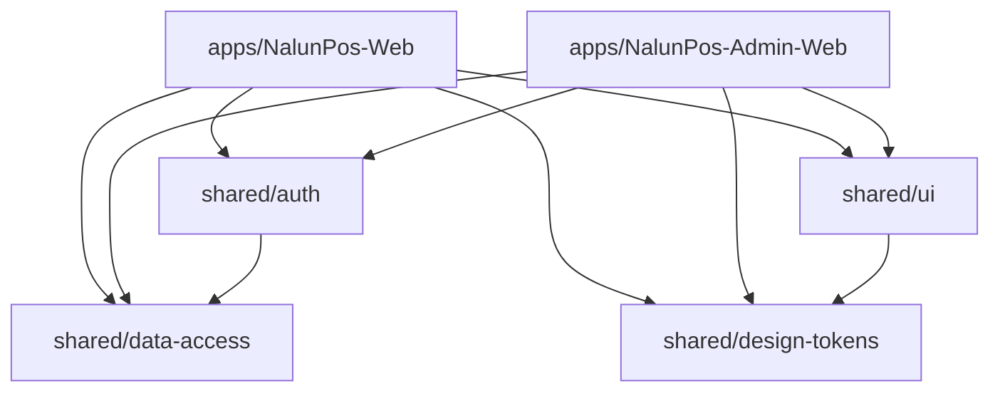

# Arquitectura Frontend — NalunPos Enterprise (Angular 22 Monorepo)

## 1. Propósito y Estructura Global

El ecosistema frontend de **NalunPos** está construido sobre un **Monorepo Nx** con **Angular 22** Zoneless, diseñado para máxima escalabilidad, rendimiento extremo y mantenibilidad a largo plazo (20+ años).

### 1.1 Aplicaciones (`apps/`)

- **`NalunPos-Admin-Web`**: Consola administrativa global para la gestión de la plataforma multi-tenant (SuperAdmin), monitoreo de sharding de bases de datos, métricas y administración de tenants.
- **`NalunPos-Web`**: Consola operativa de negocio (Admin Comercial / Tenant / Cajero), enfocada en el punto de venta (POS), ventas, inventario, almacenes, proveedores y clientes.

### 1.2 Librerías Compartidas (`libs/shared/`)

- **`libs/shared/auth`**: `AuthService`, interceptores de autorización y control de sesión (`authTokenInterceptor`, `sessionExpiredInterceptor`), guards funcionales (`authGuard`, `roleGuard`), interfaces tipadas y modelo de sesión de usuario `UserSession`.
- **`libs/shared/data-access`**: Configuración dinámica de runtime (`APP_CONFIG`, `AppConfigService`), interceptores globales (`correlationIdInterceptor`, `errorInterceptor`) y modelos de error estandarizados (`ProblemDetails`, `AppError`).
- **`libs/shared/ui`**: Componentes visuales puros reutilizables (`AppShellComponent`, `HeaderComponent`, `SidebarComponent`, `BaseLoginComponent`, `PageHeroCardComponent`, `MetricsBentoGridComponent`, `QuickFilterBarComponent`, `AdvancedFilterDrawerComponent`, `NotificationService`).
- **`libs/shared/design-tokens`**: Fuente única de verdad visual M3 (`theme.css`), tokens de diseño semánticos y tipografías auto-alojadas (`@fontsource`).

---

## 2. Regla de Dependencias y Module Boundaries (Clean Architecture)

El monorepo hace cumplir fronteras arquitectónicas automáticas mediante `@nx/enforce-module-boundaries` en ESLint:



1. **`apps/*`** consumen `libs/shared/*` según su scope (`scope:web`, `scope:admin-web`).
2. **`libs/shared/*`** **NUNCA** importan código de `apps/*`.
3. **`libs/shared/ui`** es de presentación pura; consume tokens de diseño y no realiza peticiones HTTP directas ni gestiona lógica de negocio.
4. **Cero Dependencias Circulares**: Cada capa tiene un flujo unidireccional estricto.

### 2.1 Cadena de Interceptores HTTP Funcionales y Orden Estricto

Ambas aplicaciones (`apps/NalunPos-Web/src/app/app.config.ts` y `apps/NalunPos-Admin-Web/src/app/app.config.ts`) configuran una cadena idéntica y estricta de interceptores HTTP funcionales mediante `provideHttpClient(withFetch(), withInterceptors([...]))`:

```typescript
withInterceptors([
  correlationIdInterceptor, // 1° — Agrega X-Correlation-Id
  authTokenInterceptor, // 2° — Agrega Authorization: Bearer <token>
  sessionExpiredInterceptor, // 3° — Maneja respuestas 401 (logout/login) y 403 (/forbidden)
  errorInterceptor, // 4° — Traduce HttpErrorResponse → AppError
]);
```

#### Flujo Bidireccional de RxJS y Mecánica Real de la Cadena

En Angular `provideHttpClient(withInterceptors([...]))`, las peticiones y las respuestas/errores recorren el arreglo en sentidos opuestos:

1. **Flujo de Peticiones Salientes (Request — Izquierda a Derecha / 1° → 4°):**
   - **`correlationIdInterceptor` (1°)**: Genera y adjunta la cabecera `X-Correlation-Id` con un UUIDv4 único a la solicitud saliente antes de que continúe su viaje.
   - **`authTokenInterceptor` (2°)**: Inyecta la cabecera `Authorization: Bearer <token>` obtenida desde `AuthService`, tras validar coincidencia exacta de origen contra `apiUrl` (ADR 0014) y mitigar colisiones de dominios o URLs malformadas.
   - **`sessionExpiredInterceptor` (3°)**: Pasa la petición intacta hacia adelante invocando `next(req)`.
   - **`errorInterceptor` (4°)**: Pasa la petición directamente hacia el backend invocando `next(req)`.

2. **Flujo de Respuestas y Errores Entrantes (Response / Error — Derecha a Izquierda / 4° → 1°):**
   - **`errorInterceptor` (4° en la lista — PRIMERO en la ruta de retorno de error):**
     Al ser el último interceptor declarado, su operador `catchError` se ejecuta en primer lugar ante cualquier fallo de red o respuesta HTTP de error. Convierte **TODOS** los errores HTTP (`HttpErrorResponse`) en instancias fuertemente tipadas de `AppError` (traduciendo `ProblemDetails` RFC 7807 o generando mensajes estandarizados para errores 400, 401, 403, 404, 500 y fallo de conexión con status 0).
   - **`sessionExpiredInterceptor` (3° en la lista — SEGUNDO en la ruta de retorno de error):**
     Recibe en su `catchError` el error ya procesado y transformado por `errorInterceptor`. Por tanto, recibe una instancia de `AppError` (o un `HttpErrorResponse` si en algún contexto aislado no intervino el conversor). La función `extractHttpStatus(error)` extrae polimórficamente el código numérico `status` de ambos tipos:
     - Si el status es `401` y la petición no es `/auth/login` (evitando cerrar sesión o redirigir cuando el usuario introduce credenciales incorrectas en el formulario de acceso), invoca `authService.logout()`.
     - Si el status es `403`, redirige a la vista `/forbidden`.
     - Finalmente, re-lanza el error (`throwError(() => error)`) para que los suscriptores y componentes consumidores reciban el `AppError` tipado.
   - **`authTokenInterceptor` (2°)** y **`correlationIdInterceptor` (1°)**:
     Dejan pasar la respuesta o el error hacia el suscriptor final sin interferir en la sesión.

#### ¿Por qué es crítico este orden y Advertencia de Integración?

- `errorInterceptor` debe estar al final del arreglo para que sea el primero en atrapar el `HttpErrorResponse` nativo en el flujo de retorno y transformarlo en `AppError`.
- `sessionExpiredInterceptor` debe preceder a `errorInterceptor` en el arreglo para que en el retorno de error se ejecute después de este, consumiendo el `AppError` unificado con `extractHttpStatus`.

> [!WARNING]
> **Advertencia de Mantenibilidad:** **NO** reordenar los interceptores en `app.config.ts`. Cualquier alteración en el orden romperá el flujo bidireccional y las aserciones de integración. Toda modificación debe ser validada contra el test de integración de la cadena completa en [`libs/shared/auth/src/interceptors/session-expired.interceptor.spec.ts`](../../libs/shared/auth/src/interceptors/session-expired.interceptor.spec.ts#L171-L285) (`describe('Cadena Completa de Interceptores HTTP (Test de Integración Real)')`).

---

## 3. Patrón Feature Slice: Contenedores Inteligentes vs. Presentación Dumb

Cada módulo funcional (ej. `warehouses`, `categories`, `suppliers`) sigue una estructura modular estándar (ADR 0011):

```
features/<feature-name>/
├── components/          # Dumb components (presentación pura, inputs/outputs puros)
├── data-access/         # Servicios HTTP reactivos y adaptadores de datos
├── models/              # Interfaces, DTOs y tipos inmutables
├── pages/               # Smart/Container components (orquestación, señales, diálogos)
└── <feature>.routes.ts  # Rutas con lazy loading standalone
```

- **Smart / Container (`pages/`)**: Inyectan servicios, orquestan el estado reactivo con Signals (`signal`, `computed`), gestionan diálogos modales y emiten notificaciones.
- **Dumb / Presentation (`components/`)**: Reciben datos vía `input()` de Angular, emiten acciones del usuario vía `output()`, y mantienen `ChangeDetectionStrategy.OnPush` estricto sin inyectar servicios HTTP.

---

## 4. Diseño Visual: Material M3 + Tailwind CSS v4

Para erradicar conflictos de especificidad CSS y preservar una identidad visual empresarial:

1. **Angular Material M3**: Resuelve componentes complejos y accesibles (tablas con ordenamiento/paginación, diálogos, selectores, tooltips, snackbars).
2. **Tailwind CSS v4**: Resuelve layouts (`flex`/`grid`), micro-animaciones, efectos Glassmorphism y espaciados responsivos.
3. **Cero `!important`**: Queda estrictamente vetado el uso de `!important` en archivos de estilos. Toda personalización se deriva de tokens semánticos en `libs/shared/design-tokens/src/theme.css`.
4. **Tipografías Auto-Alojadas (Zero External Requests)**: Fuentes corporativas (`@fontsource/plus-jakarta-sans`, `@fontsource/inter`, `@fontsource/jetbrains-mono`, `@fontsource-variable/material-symbols-outlined`) alojadas localmente sin dependencias externas hacia CDN de Google Fonts.

---

## 5. Configuración en Runtime (12-Factor App)

Las aplicaciones no contienen URLs de backend hardcodeadas (ADR 0009 y ADR 0014):

- **Modelo en Producción**: El build de producción **NO** empaqueta ningún archivo `config.json` en `dist/` ni en `public/`. Los artefactos compilados son completamente inmutables.
- **Suministro Externo en Despliegue**: El entorno de hosting (Cloudflare Pages, Nginx, CDN o contenedor) provee `/config.json` copiando y adaptando la plantilla `apps/<app>/config/config.example.json` junto a los artefactos estáticos (ADR 0014).
- **Inyección y Validación Fuerte**: En el arranque (`main.ts`), `provideAppInitializer()` solicita `/config.json`, validándolo estrictamente mediante `validateAppConfig` e inyectándolo a través del token fuertemente tipado `APP_CONFIG`.
- **Desarrollo Local vs Producción**:
  - En desarrollo, si `/config.json` no está presente, se utiliza un fallback transparente derivado de `environment.ts` (`https://localhost:7232`).
  - En producción, opera bajo un principio **fail-closed**: si `/config.json` no existe (HTTP 404) o sus campos son inválidos, la aplicación detiene su inicialización e impide realizar peticiones a endpoints no autorizados.
- **Principio "Build Once, Deploy Anywhere"**: El mismo artefacto compilado se despliega en cualquier infraestructura modificando exclusivamente el archivo `/config.json` externo.

---

## 6. Estrategia de Calidad y Pruebas Automatizadas

1. **Pruebas Unitarias Rápidas con Vitest**:
   - Ejecutadas en entorno `jsdom` con inicialización JIT nativa de Angular 22 (`@angular/compiler` + `@angular/platform-browser/testing`).
   - Cobertura de código monitoreada con `@vitest/coverage-v8`: 165 tests unitarios en 28 suites pasando al 100%, con cobertura global de 43.95% de líneas en el monorepo y cobertura real por librería:
     - **`libs/shared/util`**: 100.00% líneas (100% stmts, 100% branches, 100% funciones).
     - **`libs/shared/auth`**: 98.13% líneas (98.21% stmts, 86.96% branches, 100% funciones).
     - **`libs/shared/data-access`**: 98.13% líneas (98.21% stmts, 93.06% branches, 100% funciones).
     - **`libs/shared/ui`**: 91.16% líneas (92.31% stmts, 63.96% branches, 95.38% funciones).
2. **Verificación Automatizada de Seguridad de Artefactos y CSP (`verify:csp`)**:
   - Herramienta nativa [`tools/verify-csp.mjs`](../../tools/verify-csp.mjs) ejecutada en CI tras el build de producción para validar la integridad de directivas CSP, hashes SHA-256 de scripts inline, ausencia total de `config.json` y de `localhost` en artefactos compilados.
3. **Pruebas E2E Smoke con Playwright**:
   - Pruebas end-to-end automatizadas en Chromium headless con interceptación de red vía `page.route()`, incluyendo intercepción de `/config.json` y monitoreo de eventos DOM `securitypolicyviolation`.

---

## 7. Directrices de Seguridad Frontend

- **Ausencia total de vulnerabilidades XSS**: 0 usos de `innerHTML` crudo y 0 usos de `bypassSecurityTrust*`.
- **Content Security Policy (CSP) Estricta (ADR 0014)**: Origen canónico fijo (`https://api.nalunpos.com`) en `connect-src`, hashes SHA-256 y cero `'unsafe-inline'` en `script-src`; `style-src` permite `'unsafe-inline'` por requerimiento dinámico de Tailwind CSS v4 y Angular Material M3, con prohibición absoluta de comodines `*` en orígenes de red.
- **Deduplicación Canónica de Datos y Tokens UI (ADR 0013)**: Centralización DRY de servicios de datos en `libs/shared/data-access` y abstracción `AUTH_GATEWAY` en `libs/shared/ui`.
- **Evolución hacia Autenticación Zero-Trust (ADR 0012)**: Almacenamiento en memoria volátil de access tokens de corta duración combinado con refresh tokens en cookies seguras `HttpOnly` y `SameSite=Strict`.

---

## 8. Registro de Decisiones de Arquitectura (ADRs) y Registros Históricos

- **Índice Maestro de ADRs**: El registro maestro de decisiones se encuentra en [`docs/architecture/adr/README.md`](./adr/README.md), abarcando desde **ADR 0001** hasta **ADR 0014**.
- **Registros Históricos de Refactorización**:
  - [Refactor F0-4: Eliminación de Duplicación entre Apps y Extracción a Shared-UI](./history/refactor-f0-4-duplication-elimination.md).
